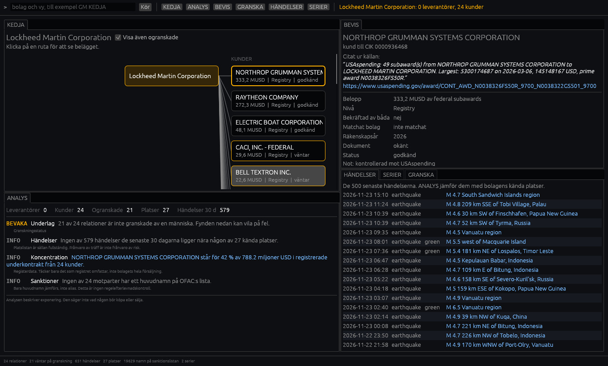

# Marknadsterminalen

Kod till projektplanen "Egen marknadsterminal i Rust". Det här är kedjemotorn
från dokument till granskad relation, med lagring, API, gränssnitt, gratis
datakällor och grunden för signalmotorn.

Kedjemotorn är körd skarpt mot SEC EDGAR med den regelbaserade extraktorn.
Språkmodellen är fortfarande inte körd. De gratis källorna i `term-sources`
är körda skarpt.

### Första körningen på riktiga årsredovisningar, 2026-11-23

- GM:s egen årsredovisning namnger inga kunder eller leverantörer. Kedjan måste
  byggas från andra hållet.
- Fulltextsökningen fann 86 bolag som nämner General Motors ihop med "accounted for".
- Av 23 lästa årsredovisningar gav den regelbaserade extraktorn två leverantörer
  till GM, med ordagranna citat: Lear Corp och PAMT Corp.
- Extraktorn missar det mesta som inte följer ett fast mönster, till exempel
  "GM and Distribution represented 59% and 9%". Det är det språkmodellen ska lösa.



Bilden är det riktiga programmet, startat på en virtuell skärm, med riktiga
uppgifter ur offentliga register hämtade 2026-11-23: Lockheed Martins
kunder enligt federala underkontrakt hos USAspending, anläggningar från EPA,
jordbävningar från USGS och OFAC:s sanktionslista.
Ny bild tas med `scripts/skarmbild.sh`.

## Flödet

```
dokument -> text -> stycken -> extraktion -> citatkontroll -> bolagsmatchning
   steg 1            steg 2      steg 3         steg 4            steg 5

-> omvänd sökning -> sammanslagning -> granskningskö -> kedjevy och API
      steg 6             steg 7           steg 8
```

## Paketen

| Paket | Ansvar | Läge |
|---|---|---|
| `term-core` | Gemensamma typer | Testat |
| `term-ingest` | EDGAR-klient, takthållare, fulltextsökning | Körd skarpt mot EDGAR 2026-11-23. Sökningen testas mot ett inspelat riktigt svar |
| `term-parse` | HTML till text, urval av stycken | Körd på 24 riktiga årsredovisningar. Inte stickprovskontrollerad mot originalen |
| `term-extract` | Extraktion, citatkontroll, facit och mått | Regelbaserad extraktor körd på riktiga dokument. Språkmodellen skriven, aldrig körd skarpt |
| `term-resolve` | Bolagsmatchning, spegling, sammanslagning | Testat på påhittade bolag |
| `term-store` | Lagring i en SQLite-fil | Testat, även mot fil på disk |
| `term-api` | HTTP-gränssnitt | Testat, och kört som server på localhost |
| `term-sources` | Tolv gratis källor utöver EDGAR | Elva körda skarpt 2026-11-23. FRED väntar på nyckel |
| `term-analysis` | Väger ihop kedja, granskning, sanktioner, platser och händelser | Testat, och kört på riktiga registerdata |
| `term-signal` | Signalkort, låst logg, fyra grindar, statistik | Testat. Innehåller ingen regel som ger signaler |
| `term-ui` | Fönstret: KEDJA, ANALYS, BEVIS, GRANSKA, HÄNDELSER, SERIER | Testat utan fönster och startat på virtuell skärm för bilden ovan. Ingen har klickat i det |
| `term-cli` | Kommandot `term` | Kört från början till slut |

## Kom igång

```sh
cargo test                 # allt utom gränssnittet, snabbt
cargo test --workspace     # allt, tar några minuter första gången
cargo clippy --workspace --all-targets -- -D warnings
```

Prova hela flödet på testdokumentet:

```sh
cargo run -p term-cli -- companies add 42 "Nordvik Test Components Inc." --ticker NTC
cargo run -p term-cli -- ingest fixtures/syntetisk_10k.html --cik 42
cargo run -p term-cli -- review list
cargo run -p term-cli -- review approve 1 --note "kontrollerad mot dokumentet"
cargo run -p term-cli -- show NTC --all
cargo run -p term-ui          # skriv NTC KEDJA i kommandoraden
cargo run -p term-cli -- serve   # http://127.0.0.1:8787/companies/42/chain?status=all
```

## Mot riktiga källor

Kopiera `.env.example` till `.env` och fyll i. Kommandot `term` läser filen själv.

```sh
# Bolagslistan som namn matchas mot. Hämta SEC:s fil company_tickers.json först.
cargo run -p term-cli -- companies import company_tickers.json

# Hämta senaste 10-K och läs in den. Kommandot skriver ut nästa rad åt dig.
cargo run -p term-cli -- fetch 1467858 --out gm_10k.htm
cargo run -p term-cli -- ingest gm_10k.htm --cik 1467858 --extractor anthropic

# Vilka bolag uppger bolaget som kund? Läs in tio av deras årsredovisningar.
cargo run -p term-cli -- reverse GM --ingest 10

# Alla gratis dokument för ett bolag: årsredovisningar, avtalsbilagor, 8-K, prospekt,
# mineralrapporter, fullmakter. Se docs/rapporter.md för vilka lagkrav som ligger bakom.
cargo run -p term-cli -- docs GM --extractor claude-cli

# Följ kedjan nedåt, led för led. Med --extractor claude-cli läser Haiku 5.5 via
# programmet `claude` (inloggat Claude Code, ingen API-nyckel). Står stilla utan inloggning.
cargo run -p term-cli -- crawl GM --depth 2 --per-level 6 --reverse-cap 120 --extractor claude-cli
```

Allt i blocket är kört utom raderna med `--extractor anthropic` och `--extractor claude-cli`.
Språkmodellvägen är bara testad mot inspelade svar och ett stand-in-program, aldrig mot en riktig modell.

## Hela världen

`term world build` hämtar Världsbankens landlista och frågar sedan källorna
land för land. Resultatet står i [docs/lander.md](docs/lander.md): varje land
med BNP, antal bolag med LEI hos GLEIF och antal årsredovisningar i det
europeiska formatet. Siffrorna är räknade av källorna själva.

Det listan visar är vad terminalen kan se i varje land i dag. Den visar inte
ländernas egna register. Nationella system står bara där projektet har
undersökt dem, och det är få.

## Räkenskaper och insiders

```sh
term fin GM        # intäkter, resultat, tillgångar, skulder, eget kapital ur SEC
term insiders GM   # de senaste insideranmälningarna, som länkar
```

Räkenskaperna sparas som serier och syns i vyn SERIER. Insideranmälningarna
listas bara. Köp, sälj och belopp läses inte ut än. Ägare enligt blankett 13F
är inte inlagt: de lämnas av förvaltaren, inte av bolaget, och kräver SEC:s
samlade dataset.

## Fler källor värda att ta in

Funna vid en genomgång 2026-11-23. Ingen av dem är inlagd.

| Källa | Ger | Varför |
|---|---|---|
| SEC `frames` | Ett begrepp för alla bolag samma period | Jämförelser mellan bolag. `companyfacts` är redan inlagt |
| SEC blankett 4 i detalj, 13F, 13D och 13G | Insiders belopp, och ägare | Blankett 4 listas redan, men läses inte ut |
| SEC blankett 8-K | Väsentliga händelser | Utlösare för kundchocken |
| Utskrifter från rapportsamtal | Kunder och leverantörer som nämns muntligt | En MIT-studie byggde kedjor ur 10-K och rapportsamtal |
| AKShare | Kinesiska marknadsdata | Planens öppna lucka för Kina |
| FINRA blankningsvolym | Daglig blankning per aktie | Gratis signalunderlag |

Öppen kod att läsa, inte kopiera: `finagg` (samlar gratis finans-API:er i SQL),
`awesome-quant` och `awesome-data` (listor över källor), och datamängden
IC-SPLC för halvledarkedjor, som är anonymiserad och därför mest ett mått att
jämföra mot.

## Gratis källor

Elva källor kräver ingen nyckel och är körda skarpt. Tolkarna testas mot
inspelade riktiga svar i `fixtures/kallor/`.

| Källa | Ger | Kommando | Läge |
|---|---|---|---|
| USGS | Jordbävningar | `term events fetch usgs` | Körd skarpt |
| GDACS | Cykloner, översvämningar, vulkaner, bränder med larmnivå | `term events fetch gdacs` | Körd skarpt |
| GLEIF | LEI för ett bolagsnamn | `term lookup lei "Volvo"` | Körd skarpt |
| OpenFIGI | FIGI för en ticker | `term lookup figi GM` | Körd skarpt utan nyckel |
| ECB | Valutakurser mot euro | `term series fetch ecb SEK` | Körd skarpt |
| Riksbanken | Kronkurser och räntor | `term series fetch riksbank SEKUSDPMI` | Körd skarpt |
| Världsbanken | Årliga makroserier per land | `term series fetch worldbank NY.GDP.MKTP.CD --country SE` | Körd skarpt |
| filings.xbrl.org | Europeiska årsredovisningar (ESEF) | `term esef SE` | Körd skarpt |
| OFAC | Sanktionslistan SDN | `term sanctions fetch`, `check`, `screen` | Körd skarpt |
| EPA FRS | Var anläggningar i USA ligger | `term locations fetch-epa LMT --search "LOCKHEED MARTIN" --state TX` | Körd skarpt |
| USAspending | Federala underkontrakt. Huvudleverantören blir kund | `term subawards LMT` | Körd skarpt |
| FRED | Amerikanska räntor och makro | `term series fetch fred DGS10` | Inte körd. Kräver gratis nyckel |

```sh
term events fetch && term events list
term series list
term sanctions fetch && term sanctions screen
```

Två varningar:

- **Sanktionskollen är ingen regelefterlevnadskontroll.** Bara huvudnamn jämförs,
  inte alias. Ingen träff bevisar ingenting.
- **Platslistan är en startlista.** EPA söker på anläggningens namn, täcker
  bara USA och ger både missar och fel träffar. Ingen händelse nära en känd
  plats betyder inte att kedjan är oberörd.

Gratis källor i planen som INTE är inlagda, och varför:

- **Kräver nyckel som inte fanns:** Census, UN Comtrade, NASA FIRMS, EIA,
  aisstream.io, EDINET och Open DART. De ska byggas mot inspelade riktiga svar.
- **Kräver er kontaktadress:** SEC:s dataset för räkenskaper, ägare och insiders.
- **Släppte inte igenom oss:** GDELT begränsar anrop per adress och svarade 429.
Open Supply Hub och OpenSky väntar på licensfrågorna i planens juristlista.

## Analysen

`term analyze LMT`, vyn ANALYS och `GET /companies/{cik}/analysis` väger ihop
allt som är känt om ett bolag:

| Område | Vad som vägs in | Larm när |
|---|---|---|
| Underlag | Hur mycket som är granskat av en människa | Relationer väntar på granskning |
| Koncentration | Redovisade kundandelar, och registerbelopp | En kund når 10 eller 20 procent |
| Enda källa | Citatet bakom varje leverantör | Bolaget själv skriver "sole source" |
| Sanktioner | Motparternas namn mot OFAC:s lista | Ett huvudnamn stämmer |
| Händelser | Jordbävningar och larm mot kända platser | En händelse ligger inom en avståndsgräns |

Varje fynd säger vad det vilar på. Analysen säger också vad den INTE kunde
kontrollera, så att ett uteblivet larm inte läses som ett friande.
Avståndsgränserna och andelströsklarna är tumregler, inte forskning.
Analysen beskriver exponering. Den säger inte vad någon bör köpa eller sälja.

## Regler i koden

- **Citatet avgör.** En relation släpps bara igenom om citatet finns i stycket
  som extraktorn fick se. Bara blanksteg och citattecken får skilja.
- **Osäker matchning tillämpas aldrig.** Bara exakt namnlikhet sätter ett CIK.
  Allt annat visas som förslag.
- **Ingenting är godkänt förrän en människa har sagt det.** API:et och
  `term show` visar bara godkända relationer om man inte ber om annat.
- **Ändrat belägg kräver ny granskning.** En relation som får nytt innehåll går
  tillbaka till kön. En ändrad stavning av namnet gör det inte.
- **Signalloggen går inte att ändra obemärkt.** Varje rad bär en kontrollsumma av
  raden före. `term signal verify-log` kontrollerar kedjan.
- **En regel kan inte hoppa över en grind.** Gränsen t över 3,0 kommer ur
  forskningen i planen. 28 veckor och 30 observationer är planens egna tumregler.
- **Facit ägs av människor.** `fixtures/*.facit.json` ändras aldrig av en extraktor.
- **Kört eller inte sant.** Varje modul säger i sin rubrik vad som är kört.

## Vad som inte finns

- Ingen regel som ger signaler. De tre signaltyperna kräver kurshistorik,
  estimat och händelsedata som projektet inte har.
- Ingen kursdata, inga handelsflöden och ingen prognosmodell. Det är planens
  del 2 och större delen av del 3.
- Ingen inloggning i API:et. Det lyssnar på localhost.
- Vyerna FILINGS, PEERS, FIN, AGARE, INSIDER, LEDNING, KARTA och KURS, och alla vyer i del 2 utom HÄNDELSER.

## Avvikelser från planen

- **SQLite i stället för PostgreSQL.** Prototypen ska gå att köra utan server.
  Schemat är vanlig SQL. Beslut om byte tas i fas 0.
- **Språkmodellen anropas direkt över HTTP**, inte genom `rig-core`.
- **HTML rensas med en egen funktion**, inte med ett tolkbibliotek.
- **Nivåerna Disclosed, Named och Reverse** har prototypens tolkning. Se `term-core`.
- **Gränssnittet läser databasen direkt**, inte genom API:et. Det räcker för en
  användare på en dator.
- **Kedjan ritas för hand, inte med `egui_graphs`.** På en riktig skärm blev
  bibliotekets etiketter oläsliga. En fri grafvy för kedjor i flera led återstår.

## Versioner som måste hållas ihop

`eframe` 0.36 och `egui_dock` 0.21 kräver båda `egui` 0.36. Senaste `egui_dock`
kräver redan 0.37. Uppgradera dem tillsammans eller inte alls.

Nästa uppgifter står i `uppgifter/nasta.yaml`.
